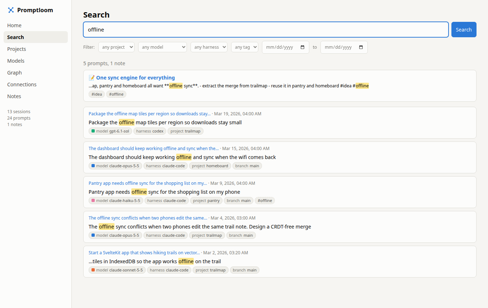
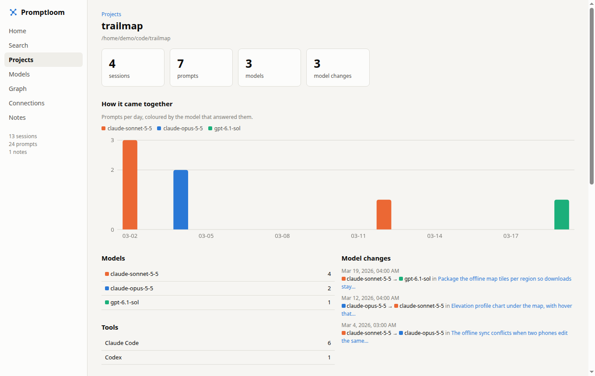
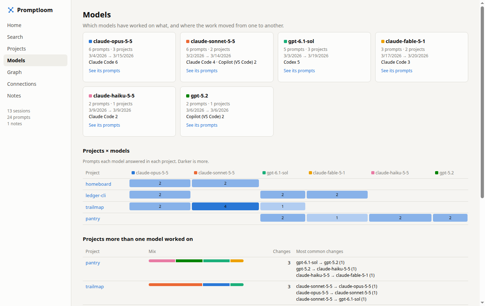
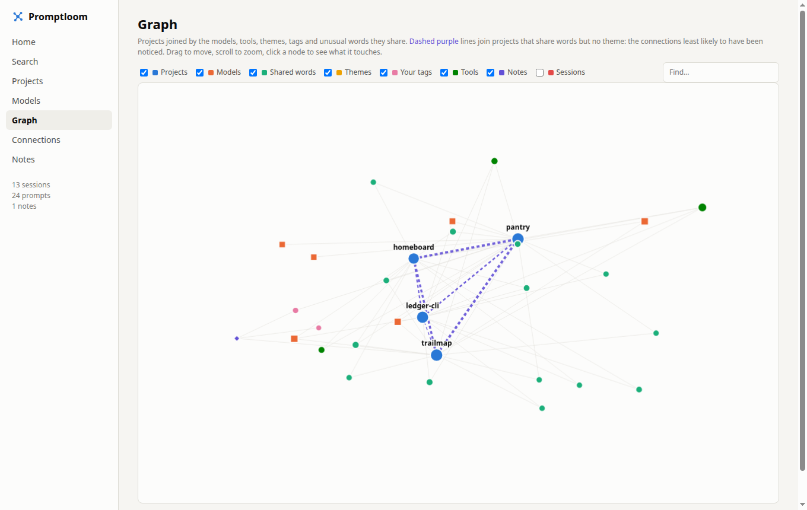
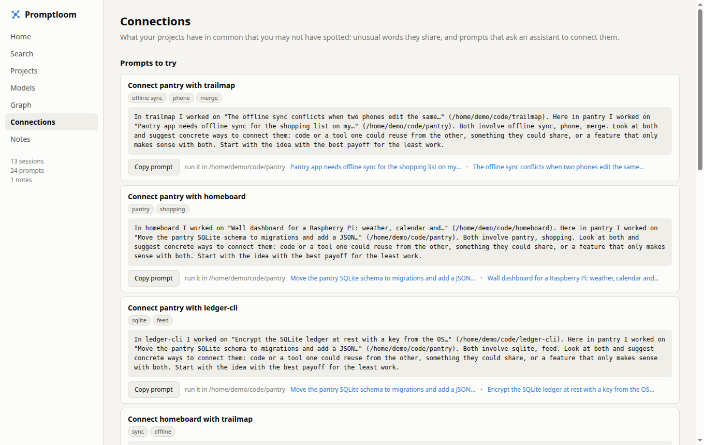

# promptloom

Keeps every prompt you type into AI coding tools (Claude Code, Codex, Copilot in
VS Code, Hermes, and any other you point it at) and lets you search them, tag
them, write notes beside them, and see how your projects connect and came
together over time.



It runs quietly in the background, reading the session logs those tools
already keep. Nothing is sent anywhere unless you choose a hosted model for
summaries. It runs on Linux, macOS and Windows.

## What you get

`promptloom app` opens the app in a window of its own, with an icon in the
dock (`promptloom ui` opens it in the browser instead). It is served from your
own machine and works offline. Press **Ctrl+K** (⌘K) anywhere to search or
jump: prompts, projects, threads, sessions, pages, or "new prompt in …".

The app is built around three things promptloom keeps for you between
sessions, tools and models:

- **Briefs**: what every assistant should know before touching a project.
  Promptloom drafts one from your history (where things stand, rules you
  have stated more than once, what went wrong before, what is still open);
  you write the part that matters on top. The composer puts it at the top of
  a prompt, `promptloom brief` prints it, and the MCP tool `project_brief`
  hands it to any assistant that asks. The point is to stop re-explaining.
- **Threads**: lines of work rather than a flat list of sessions. Sessions in
  a project whose prompts share unusual words, close in time, are grouped
  with the drafts and pull requests for that folder, across tools and models.
  Rename, pin or close them.
- **Hand-offs**: from any session, "Continue in …" opens the composer with a
  prompt that picks the work up in another tool or model: what was done, the
  last things asked, what is open, and the brief.

- **New prompt** is where a prompt starts: pick the tool (Claude Code, Codex,
  the Copilot CLI, Hermes, pi, OpenClaw, VS Code, Cursor; only the installed
  ones are offered), the model and the project, write, and open the tool on
  it. A terminal opens in the project with the tool already running your
  prompt; the tool's own log then brings it into your history like any other.
- **Weave** turns a rough draft into a stronger prompt: the draft goes to a
  model you already use for summaries (local Ollama, or a provider with a
  stored key), which sends back a version with the goal, what done looks
  like and the constraints spelled out. Both versions are kept.
- **Drafts** keep every prompt you are still working on, saved as you type,
  so a thought is never lost before it reaches a tool.

- **Search** every prompt from every tool, newest first. Filters go in the
  query: `model:opus project:shop harness:codex tag:idea theme:auth
  branch:main after:2026-01-01 before:2026-02-01 "exact phrase"`.
- **Tags on every prompt**: the model that answered it, the tool, the project
  and the git branch are added automatically. Add your own to a session or to
  a single prompt, and search by them.
- **Notes** of your own, in Markdown, attached to a project or a session. They
  show up in search and on the graph.
- **Projects** shows each project's activity day by day, coloured by model, and
  every point where the work moved from one model to another.
- **Loom** (home) shows your threads, what needs you (drafts waiting, pull
  request feedback, open action items) and what promptloom suggests.
- **Models** shows which models worked on which projects, the projects several
  models shared, and the most common hand-offs.
- **Tools** does the same for the tools themselves, apart from the models
  behind them: how much each has done, where, and with which models.
- **Graph** joins projects through the models, tools, themes, tags and unusual
  words they have in common. Dashed purple lines are links no theme explains:
  the ones you and the AI are least likely to have noticed.
- **Connections** turns the strongest links between projects into ready-to-paste
  prompts that ask an assistant how to connect them.
- **Pull requests** (off until you switch it on) lists yours and the ones
  others opened in your repositories, per project. Claude Code, Codex or
  Copilot reviews one with anything you add to the prompt, and when someone
  comments on yours a notification offers to fix it. See below.
- **Worktrees** sets up a worktree for a branch, and finds the ones you can
  remove without losing anything.

| | |
| --- | --- |
|  |  |
|  |  |

The screenshots use made-up projects from `scripts/demo.py`.

A menu bar icon (a GNOME Shell extension on Linux, a small native app on macOS)
shows the session you are in, your recent sessions and a quick-capture box.

## Supported tools

| Tool | How | Model per prompt |
| --- | --- | --- |
| Claude Code | `~/.claude/projects` | yes |
| Codex (CLI and desktop) | `~/.codex/sessions` | yes |
| GitHub Copilot Chat in VS Code | VS Code's `workspaceStorage/*/chatSessions` | yes |
| Hermes | `~/.hermes/state.db` | when recorded |
| Anything that writes JSON lines | a few lines of config | if it logs one |
| Anything else | `promptloom log`, the HTTP API, or a Python plugin | if you pass it |

Claude Code and Codex have been run against real logs. The Copilot and Hermes
adapters follow those tools' storage formats and are tested on synthetic files;
reports from real installs are welcome.

### Sending prompts from other tools

From a script, a git hook or an editor task:

```sh
promptloom log --harness aider --model gpt-6 "make the importer resumable"
```

Or over HTTP, while the daemon is running:

```sh
curl -X POST http://127.0.0.1:8765/api/ingest -H 'Content-Type: application/json' \
  -d '{"harness": "aider", "context": "/path/to/project", "prompt": "…", "model": "gpt-6"}'
```

`context` is the project directory. Add `session` to group prompts into one
session; without it, prompts from the same tool and directory on the same day
are grouped together. A list of such objects is accepted too.

### Letting assistants read your history (MCP)

`promptloom mcp` is a Model Context Protocol server, so an assistant can search
what you asked before, look up how a project came together, or find related
work in your other projects.

```sh
claude mcp add promptloom -- promptloom mcp          # Claude Code
```

```toml
# ~/.codex/config.toml (Codex)
[mcp_servers.promptloom]
command = "promptloom"
args = ["mcp"]
```

```json
// .vscode/mcp.json (Copilot in VS Code)
{ "servers": { "promptloom": { "type": "stdio", "command": "promptloom", "args": ["mcp"] } } }
```

Its tools are `project_brief` (read this first), `search_prompts`,
`project_history`, `related_work`, `list_projects` and `capture_note`. It
reads your history and can add to your inbox; it changes nothing else.

## Install

Needs Python 3.11+ and [uv](https://docs.astral.sh/uv/) (or pipx).

```sh
git clone https://github.com/craigcampbell/promptloom
cd promptloom
./install.sh
```

**Linux** installs the `promptloom` command, a systemd user service, and the
GNOME top bar extension (skipped without GNOME). Nothing needs sudo. On Wayland
a new extension only appears after you log out and back in.

**macOS** installs the command, a launchd agent, and builds the menu bar app
into `~/Applications` (needs the Xcode Command Line Tools: `xcode-select
--install`). See [macos/README.md](macos/README.md).

**Windows** (PowerShell): `powershell -ExecutionPolicy Bypass -File
windows\install.ps1` installs the command, a scheduled task that runs the
daemon at sign-in, and a Start menu shortcut for the app. There is no tray
icon on Windows yet; the app window and its taskbar icon stand in for it.
Notifications are Windows toasts without buttons. The Windows pieces follow
the same code as Linux and macOS but have not been run on a Windows machine
yet; reports welcome.

**Elsewhere**, `uv tool install .` and run `promptloom watch` however you like
to keep things running.

### The app in a window

`promptloom app` (and the launcher `install.sh` adds to the applications menu)
shows the app in a window of its own rather than a browser tab, so it can sit
in the dock like any other app. It uses, in order: [pywebview](https://pywebview.flowrl.com)
if installed (`uv tool install --with pywebview --editable .`; on Linux it
needs the system's PyGObject and WebKitGTK), a Chromium-family browser in app
mode (Chrome, Chromium, Brave, Edge), or the default browser. `window` in the
`[ui]` section of the config picks one.

`./uninstall.sh` removes the service, the menu bar item and the command, and
leaves your captured history and config alone.

To try the app without your own history:

```sh
python scripts/demo.py ~/promptloom-demo   # prints the command to open it
```

## Commands

```
promptloom app [PAGE]          open the app in a window of its own (--install: menu entry)
promptloom new -t TOOL TEXT    start a tool on a prompt here (-m MODEL, -C FOLDER)
promptloom brief [PROJECT]     what an assistant should know first (--short for a prompt)
promptloom ui [QUERY]          open the app in the browser (search for QUERY)
promptloom search WORDS        search from the terminal (--json for scripts)
promptloom status              active and recent sessions
promptloom capture TEXT        save a note against the active session
promptloom capture --todo TEXT save an action item (or start TEXT with "todo:")
promptloom log TEXT            record a prompt from any tool (see above)
promptloom mcp                 MCP server on stdio
promptloom harnesses           what is configured and what was found
promptloom sync                capture once (the daemon does this every 5 s)
promptloom sync --all          also summarise every pending session now
promptloom insights            ask the model what connects your sessions, now
promptloom provider ...        use a hosted model for summaries (below)
promptloom pr on|off           watch pull requests (and get notified about comments)
promptloom pr [list|check]     pull requests per project; check asks GitHub now
promptloom pr review URL       review it in the background (--agent, --add "…")
promptloom pr fix URL          a terminal where the agent works on the feedback
promptloom worktree            worktrees of your checkouts; stale ones marked
promptloom worktree add P B    a worktree for branch B of project P (--base REF)
promptloom worktree clean      remove the stale ones (asks first)
promptloom watch               run continuously (what the service runs)
```

Logs: `journalctl --user -u promptloom -f` on Linux,
`~/Library/Logs/promptloom.log` on macOS.

## Starting a prompt

Each tool is started with the prompt on its command line, and the model when
you pick one:

| Tool | Started as |
| --- | --- |
| Claude Code | `claude --model M "prompt"` |
| Codex | `codex -m M "prompt"` |
| Copilot CLI | `copilot --model M -i "prompt"` |
| Hermes | `hermes -m M chat --query-file F` |
| pi | `pi --model M "prompt"` |
| OpenClaw | `openclaw --model M agent --message "prompt"` |
| VS Code, Cursor | `code DIR` / `cursor DIR`, with the prompt on the clipboard |

The model box offers the models that tool has been seen using in your history,
then a few known ones; leave it blank for the tool's default. If a tool takes
different flags on your machine, or you use another one, set it under
`[tools.agents.<name>]` in the config (see the comments there). `promptloom
new` does the same from a terminal.

## Pull requests

Switch it on in the app's **Pull requests** page, or with `promptloom pr on`.
It needs the [GitHub CLI](https://cli.github.com) signed in (`gh auth login`)
and asks GitHub every 5 minutes for your open pull requests, the ones others
opened in your repositories, and the ones waiting for your review. Each is
shown under its project, with the session that mentioned it when there is one.

- **Review…** runs Claude Code, Codex or the Copilot CLI (whichever you pick
  and have installed) in the background, in your checkout so it can read the
  code around the change. It looks at correctness, quality, conciseness, tests
  and the description. Whatever you type in the box is added to the end of
  the prompt, and you can see the whole prompt before it starts. The agent may
  only read; nothing is posted to GitHub. You get a notification when it is
  done, and the review is kept in the app (and in `Reviews/` in Obsidian).
- **Fix…** opens a terminal with the agent working on the feedback: new
  comments from GitHub and the last review promptloom ran. By default it works
  in a worktree of its own (`<checkout>/.worktrees/<branch>`), so your
  checkout is left as it is. It commits and pushes, and asks before replying
  on the pull request.
- When someone comments on one of your pull requests, a notification says so,
  with buttons to fix it or open it. A comment counts as new when it came after
  your last push and after you last answered in that thread or conversation.
  Comments from bots (deploy previews, coverage) don't count; reviews from
  them do.

The agent commands are set in `[prs.agents.<name>]` in the config, if yours
take different flags. The switches in the app are saved to
`~/.config/promptloom/settings.toml`, which overrides `config.toml`.

## Worktrees

The **Worktrees** page (or `promptloom worktree`) lists the extra worktrees of
every checkout promptloom knows: your projects, and the other checkouts in the
folders that hold them. It can add one for a new or existing branch, in
`<checkout>/.worktrees/<branch>`, which it tells git to ignore.

A worktree is **stale** when removing it loses nothing: no uncommitted or
untracked files, every commit already on a remote, not locked, and no program
running in it. Those can be cleaned up in one go, after you confirm. Each is
checked again just before it is removed, and git itself refuses to remove one
with changes. Deleting the local branches as well is optional, and git keeps
any that are not merged.

## How connections are found

Themes come from the model and only connect what it thought to group. To find
the rest, promptloom compares the words and two-word phrases of every session's
prompts, weighting the ones few sessions use (TF-IDF). Sessions in different
projects that share such words are linked, and the words are listed as the
reason. This needs no model, so it works for every session.

- **Shared words** are words that turn up in more than one project.
- **Hidden links** join projects that share unusual words but no theme.
- **Prompts to try** come first from links between two real projects (a
  directory with `.git`, a README or a package manifest, as opposed to `~` or
  `~/Downloads`), then from the model's insights once it has run.

Model hand-offs are worked out from the model recorded with each prompt: each
time consecutive prompts in a project were answered by different models.

## Summaries

A model can add a title, summary, themes and action items to each session. By
default that is a local Ollama model (`qwen3.8:27b`), so prompts never leave the
machine. A session gets its first summary once it has been quiet for a minute,
and a refreshed one after it has grown and then sat idle for 15 minutes.

Loading that model takes about 17 GB of VRAM. If less than
`min_free_vram_mib` is free promptloom runs it on CPU instead, which takes a
minute or two per session. Set `gpu_busy = "wait"` to defer instead, or
`backend = "none"` to turn summaries off; you still get capture, search, tags,
notes, the graph and timelines.

### Using a hosted provider with your own API key

```sh
promptloom provider set openrouter --model <model>   # prompts for the key, hidden
promptloom provider set anthropic                    # model defaults to claude-opus-5-5
promptloom provider set openai                       # no --model: lists the provider's models
promptloom provider set custom --base-url https://host/v1 --model <model>
promptloom provider                                  # what is active, which keys are stored
promptloom provider local                            # back to the local model; keys kept
promptloom provider forget openrouter                # delete a stored key
```

Built in: `anthropic`, `openai`, `deepseek`, `openrouter`, `gemini`, `groq`,
`mistral`, `xai`, `together`, and `custom` for any OpenAI-compatible API.
`set` makes one small test request and saves nothing if the key or model is
rejected. Keys live in `~/.config/promptloom/provider.toml`, readable only by
you.

A hosted provider is much faster than the CPU fallback, but your prompts from
every tool are sent to it to be summarised, and each summary is billed to your
key. Pick a small model: a summary is a few thousand tokens in and a couple of
hundred out.

## Obsidian (optional)

promptloom can also write everything into an Obsidian vault: a note per
session, hub notes per project, theme, tool and shared word, a canvas map,
action items, links and insights. Set the vault in
`~/.config/promptloom/config.toml`:

```toml
vault = "~/Obsidian"
folder = "Promptloom"   # the folder inside the vault promptloom owns
```

Then run `promptloom init` and open the vault folder in Obsidian once with
"Open folder as vault". Write below the generated block in any note and it is
kept; tick action items in Obsidian and promptloom picks that up.

## Adding a harness

**A harness that logs JSON lines** needs only config. Point the generic adapter
at its files and say where each field lives:

```toml
[harness.deepseek]
type = "jsonl"
label = "DeepSeek"
glob = "~/.deepseek/sessions/*.jsonl"
session_id = "@stem"          # the file name; or a dotted path into each line
role = "role"
user_value = "user"
assistant_value = "assistant"
text = "content"              # a string or a list of {"text": ...} blocks
timestamp = "timestamp"       # ISO string or epoch seconds/milliseconds
cwd = "cwd"
title = "title"
model = "model"
resume = "deepseek --resume {id}"
```

**Anything else** is a small Python class in
`~/.config/promptloom/harnesses/<name>.py`:

```python
from pathlib import Path
from promptloom.harnesses import JsonlHarness

class MyTool(JsonlHarness):
    type = "mytool"            # harness name
    label = "My Tool"
    resume = "mytool resume {id}"

    def sources(self):
        return Path("~/.mytool/logs").expanduser().glob("*.jsonl")

    def record(self, rec, path, cursor, get):
        if rec.get("kind") != "prompt":
            return None
        session = get(rec["session"])          # created on first use
        session.context = rec.get("dir", "")
        session.set_model(rec.get("model", ""))
        session.add_prompt(rec.get("time", ""), rec["text"])
        return session.session_id
```

Subclass `Harness` instead and implement `read()` for storage that is not
line-delimited JSON (see `promptloom/harnesses/hermes.py` for SQLite and
`copilot.py` for whole JSON documents). The daemon picks up new plugins and
config changes without a restart. Pull requests adding built-in adapters are
welcome.

## Privacy

Everything stays on your machine: prompts in
`~/.local/state/promptloom/state.json`, your notes and tags in `user.json`
beside it. The app listens on 127.0.0.1 only, refuses requests addressed to any
other host name, and refuses writes from other web pages.

Values that look like credentials (`sk-…` keys, GitHub and AWS tokens,
`PASSWORD=…` style assignments, private keys) are shown as `[redacted secret]`
in the app and the vault, but that is a pattern match, not a guarantee: a bare
random token you pasted will be kept. `ignore_contexts` in the config excludes
whole directories.

Pull requests are off until you switch them on. Then promptloom talks to
GitHub through your `gh` sign-in. A review sends the pull request's diff to
whichever agent you chose, as that agent would if you had asked it yourself.

## Development

```sh
uv run --with pytest pytest
python scripts/demo.py /tmp/promptloom-demo
```

The app is plain HTML, CSS and JavaScript in `promptloom/ui` with no build
step; the server is `promptloom/server.py` (standard library only). The menu
bar items only read `~/.local/state/promptloom/status.json` and call
`promptloom capture`, so the daemon can be developed without touching them.

## License

MIT. See [LICENSE](LICENSE).
